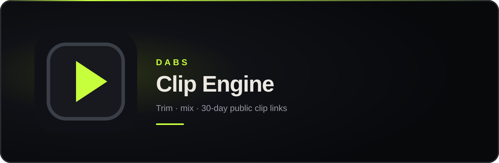

<p align="center">
  
</p>

<h1 align="center">Dabs Clip Engine</h1>

<p align="center">
  <strong>Trim the take. Mix the audio. Send a 30-day clip link.</strong>
</p>

<p align="center">
  A native Windows and Linux app for turning long recordings into tight, shareable clips — without giving the cloud your originals.
</p>

<p align="center">
  <a href="https://github.com/aaronfisher-code/clip-engine/releases/latest"></a>
  <a href="https://github.com/aaronfisher-code/clip-engine/releases/latest"></a>
  <a href="https://github.com/aaronfisher-code/clip-engine/releases/latest"></a>
</p>

<p align="center">
  <a href="https://github.com/aaronfisher-code/clip-engine/releases/latest"><strong>Download the latest build</strong></a>
</p>

---

## Get the app

Open the **[latest GitHub Release](https://github.com/aaronfisher-code/clip-engine/releases/latest)** and download the file for your computer. You do not need to install FFmpeg or other developer tools — those come with the app.

| If you use | Download this |
| --- | --- |
| **Windows** | The file ending in `_x64-setup.exe` |
| **Linux (easiest)** | The `.AppImage` — make it executable, then double-click it |
| **Debian / Ubuntu** | The `.deb` package |

After you install once, the app can update itself. On launch it checks GitHub for a newer release, and you can also choose **Check for updates** anytime.

Windows may show a SmartScreen warning the first time because the installer is not yet widely signed. Choose **More info**, then **Run anyway**. The Windows installer includes an optional **Create a clip in File Explorer** checkbox; uncheck it if you do not want a right-click item on videos. Linux AppImages need execute permission once (`chmod +x` on the file, or your file manager’s “Allow executing” option).

---

## What it is for

Clip Engine is for people who already record — games, streams, sessions — and want a fast path from a long file to a public link.

Work stays on your machine. You import recordings, play them at the original frame rate (including 120 fps), mark in/out points, pick which audio tracks to keep, and export a 1080p clip. Publishing uploads only that finished clip, not the source file. Recipients open a normal web page; they never need this app.

```text
Record  →  trim & mix locally  →  publish 1080p  →  send the link
```

---

## Features

**Cut on the original file.** Preview uses the recording you already have. Seeking is frame-accurate, hardware decode is used when the GPU allows it, and video is not re-encoded just to watch it.

**Mix audio without cooking the picture.** Enable one track or several. The mix happens in the player; video stays untouched until you export.

**GPU encode when you have it.** NVIDIA NVENC, Intel Quick Sync, and AMD AMF are detected at runtime, with a CPU fallback if needed. Output supports native display rates up to 240 fps when the capture path and encoder allow it.

**Right-click to clip (Windows).** The installer can add a **Create a clip** item to File Explorer. It is a checkbox during setup, so you can leave it off. Choosing it opens that video in Clip Engine.

**OBS-aware import.** Grab files with the system picker, or drop them from an inbox under your Videos folder.

**Built-in replay recorder.** Open **Recorder** to select a display, route
system/microphone and optional per-application audio to separately named MKV tracks, and on
Windows optionally capture separately routed playback devices, choose a reported
frame rate (including 120–240 fps when the capture path supports it), set the
replay length, and bind a global save hotkey. Saving a clip shows a desktop
notification with a short system sound so you can confirm the buffer worked
while a game is focused; failures (including pressing the key when the buffer
is not running) notify the same way. **Automatic** mode chooses a shared-texture
hardware AV1, HEVC, or H.264 encoder in that order, with software H.264 as the
safe fallback. It follows OBS 32's Simple recording policy for NVENC, AMF, QSV,
VideoToolbox, and x264, and leaves unrelated controls at each encoder plugin's
native defaults. Automatic preserves the selected resolution—including native
1440p and 4K—and adapts family-specific settings to its pixel workload. Hardware
frame rate is capped at 60 fps; software fallback is capped at 30 fps and moves
to x264's low-CPU preset for large canvases. **Advanced** remains available for
high-refresh capture or explicit encoder tuning. On Windows, capture prefers
Windows Graphics Capture for stable Alt+Tab transitions and falls back to DXGI
desktop duplication if WGC cannot initialize; neither path injects into the
captured game. The Recorder panel reports cumulative late-render and
encoder-skip counters so performance problems are visible. Advanced exposes
only controls reported by the active encoder. MKV remains the safe default
because it survives interruptions and preserves separate tracks; MP4 is
available for workflows that require it. The libobs helper is a separate
process and is started lazily, so the editor does not carry OBS's runtime
during ordinary library work.

**System tray capture.** Clip Engine can stay resident in the Windows notification area or Linux
system tray. Closing the editor hides it instead of stopping the replay buffer; the tray menu can
show the editor, start or stop the buffer, save the last replay, or quit. Launch at login is
enabled by default and starts the app hidden with the replay buffer active; it can be disabled in
the Recorder panel. A red dot on the tray icon indicates that the replay buffer is running. Linux
desktops need a StatusNotifier/AppIndicator host (GNOME may require a tray extension), and
Wayland compositors can still restrict global hotkeys.

The recorder bundles the matching libobs runtime in release packages. Hardware
encoders still require the current vendor driver (for example, an NVENC-capable
NVIDIA driver); installing OBS Studio separately is not required.

On Windows, application routes use WASAPI process loopback and remain tied to
the selected executable even when a window title changes. On CachyOS/Linux,
application routes use the `linux-pipewire-audio` OBS plugin and match the
PipeWire application executable/name; the plugin reconnects when the app starts
or its audio stream appears. System and microphone capture continue to use the
default PipeWire/PulseAudio devices. On Linux, enable **Exclude enabled
application tracks from System audio** in the Recorder audio settings to keep
selected application audio (for example, Discord) out of the system track.
Windows keeps the normal WASAPI output mix in the system track, so process
application tracks there are separate but can overlap the system audio. To avoid
that overlap, route apps through Voicemeeter or Windows per-app output settings,
then add the resulting **Playback-device tracks** in the Recorder audio tab.
Those tracks capture individual Windows render endpoints using their opaque
device IDs; they do not provide automatic Windows process subtraction. Disable
the default System audio route when you want only the explicitly routed
endpoints, and refresh/re-add a route if a virtual device is recreated.

Recording memory is measured on the helper rather than capped artificially:
encoded replay storage is approximately `bitrate × replay seconds ÷ 8`, plus
OBS and capture overhead. Hardware encoding and shorter buffers keep 1080p120
and 1440p120 efficient; longer, higher-quality, or software-encoded buffers
naturally use more memory.

**A library that stays yours.** Clips live in a local library on your PC. Licensed teammates also see a shared cloud library of what the group has published.

**Links that expire.** Published clips get a public page with a preview image, then disappear after 30 days. You can extend a clip or revoke access when you need to.

---

## Sharing a clip

Anyone with the link can watch. The page looks like a finished product — title, duration, quality, who uploaded it — and works in Discord, browsers, and anywhere Open Graph previews show up.

- Each published clip gets its own public page — no account needed to watch
- Links last **30 days** from publish (or from the last time you extend them)
- Deleting a published version removes the online video and thumbnail
- Deleting a local clip permanently removes its original recording from your device

---

## Publishing licences, without accounts

Publishing is limited to people who have a licence from the owner. Watching a shared link does not require a licence.

1. Install the app and edit clips normally—there is no registration or sign-in screen.
2. When you first choose **Publish**, enter the licence key the owner sent you.
3. Choose the display name that should appear beside your published clips.
4. The app securely remembers that licence on this device until you remove it or the owner revokes it.

Owners generate keys under **Manage access**, copy each key once, and send it privately. A revoked licence immediately loses API and publishing access; restoring it requires the recipient to enter the same key again. Clip Engine never asks members for an email address, username, or password.

---

## What stays on your computer

| | |
| --- | --- |
| Original recordings | Deleted when you choose **Delete from device**; otherwise left where you saved them. |
| Local library | Windows: `%LOCALAPPDATA%\dev.dab.clip-engine`<br>Linux: `~/.local/share/dev.dab.clip-engine` |
| Sign-in | Stored in Windows Credential Manager or the Linux keyring — not in a random file on disk |
| Cloud upload | Only the published 1080p clip and its thumbnail, with short-lived credentials scoped to those two files |

---

## For developers and operators

Building from source, deploying the Cloudflare Worker, or shipping installers is documented separately so this page can stay about using the product.

- **[Setup guide](docs/SETUP.md)** — local development, production cloud, owner onboarding, and release publishing
- **[Security model](docs/SECURITY.md)** — trust boundaries, credentials, and revocation

The desktop is a native Rust app. Official installers are built in CI and attached to GitHub Releases; that is also how in-app updates are delivered.
